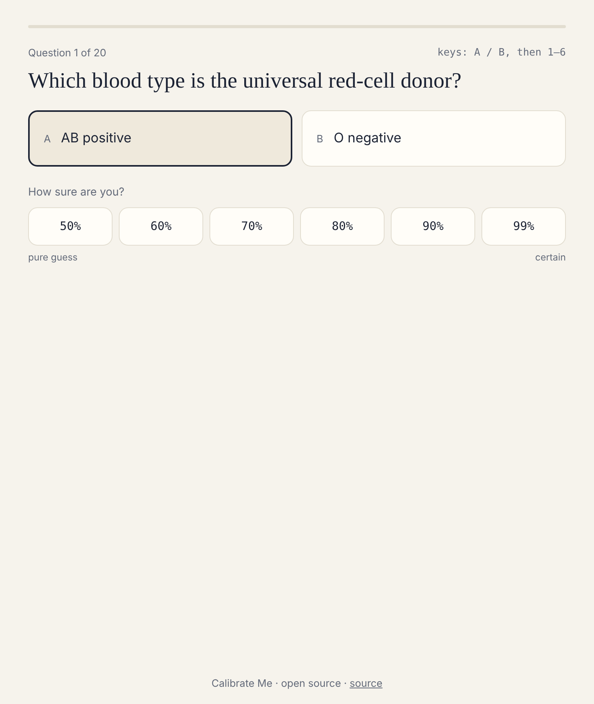
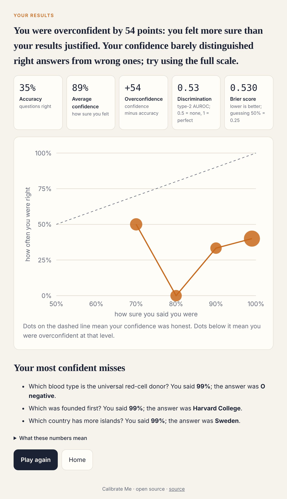

# Calibrate Me

[](https://github.com/kishoren18-hue/calibrate-me/actions/workflows/ci.yml) [](LICENSE)

**A game that measures whether your confidence is honest, with live classroom dashboards and a head-to-head comparison with Claude.**

You answer two-choice questions and say how sure you are each time. At the end you see two things most people have never measured about themselves:

* **Calibration:** when you said 80%, were you right about 80% of the time?
* **Discrimination** (metacognitive sensitivity): were you more confident on the answers you got right than on the ones you got wrong?

These are the measures cognitive scientists use to study human confidence, and the ones AI researchers use to check whether a language model knows when it's wrong.

| Play | Results |
|---|---|
|  |  |

## Features

**For players**
* Rounds of 10, 20 or 40 questions, full keyboard play (A/B, then 1–6), screen-reader labels.
* Results with a calibration chart, Brier score with its Murphy decomposition, and your most confident misses.
* Share links that carry only aggregate scores, never answers.

**For teachers**
* Sign in with an emailed link, create a class, get a 6-character code.
* Students join with the code and a nickname. **No student accounts, emails or passwords.**
* A live dashboard: each student's calibration, the class calibration curve, and the questions that fooled the most people. Delete a student's round or the whole class at any time.

**Humans vs. Claude**
* Claude answers every question twice (options swapped, to cancel position bias) and rates its confidence on the same scale players use.
* Anonymous, aggregate player data is plotted against Claude's on one calibration chart, with the questions where people and Claude differ most.

## Architecture

```
Next.js 15 · React 19 · TypeScript · Tailwind CSS
   │
   ├── solo / class play ──► Supabase RPC cm_submit_session  (validates, scores, rate-limits)
   ├── teacher dashboard ──► Supabase Postgres, row-level security  +  Supabase Auth (magic link)
   └── humans vs. Claude ──► Supabase RPCs (aggregates only, n ≥ 5)  +  claude-answers.json

GitHub Action "ask claude" (manual) ──► scripts/ask_claude.py ──► commits src/data/claude-answers.json
```

### Data and privacy design

| Who | Can do |
|---|---|
| Anyone | Play; submit a round through one validated function |
| Students | Join with a code and nickname; nothing else is collected |
| Teachers | Read and delete rounds in classes they own; nothing else |
| The public | Read per-question aggregates with at least 5 answers |

* Players can't write to tables directly. `cm_submit_session` checks the format, computes every score on the server (accuracy, Brier, type-2 AUROC), and limits each network to 60 rounds a day using a one-way hash; raw IP addresses are never stored.
* Deleting a class deletes every round and answer in it.
* `supabase/tests/rls_test.sql` checks all of this as an anonymous player, the owning teacher and another teacher, and runs in CI against a real Postgres.

## Run locally

```bash
npm install
cp .env.example .env.local   # optional: Supabase URL + anon key
npm run dev
```

Without Supabase, solo play works and classes / humans-vs-Claude show a "not configured" state.

## Tests

```bash
npm test            # scoring math, share links, question bank (Vitest)
npm run lint && npm run typecheck && npm run build
```

CI also applies the database migration to Postgres and runs the security tests.

## Deploy

1. Create a Supabase project and run `supabase/migrations/0001_calibrate_me.sql`.
2. Import the repository into Vercel and set `NEXT_PUBLIC_SUPABASE_URL`, `NEXT_PUBLIC_SUPABASE_ANON_KEY` and `NEXT_PUBLIC_SITE_URL`.
3. In Supabase → Authentication → URL configuration, add the site URL and `<site>/auth/callback`.
4. To fill in the Claude comparison, add the `ANTHROPIC_API_KEY` repository secret and run **Actions → ask claude**.

## Use in a classroom

1. Create a class and put the join link on the board.
2. Everyone plays one round. Look at the class curve together: where is it below the line?
3. Discuss the questions that fooled the most people. Why did they feel certain?
4. Open **Humans vs. Claude**. A chatbot's tone of certainty is a confidence signal too. Is it more honest than ours?

## Adding questions

Questions live in `src/data/questions.json` (`id`, `question`, `options`, `correct`, `explanation`). Good questions have one indisputable answer; counterintuitive ones are the most useful because they produce confident mistakes. Keep existing ids stable, since stored answers refer to them.

## Why I built this

My research is on calibration in language models: whether a model's confidence matches its accuracy and whether it can tell its right answers from its wrong ones. I run AI literacy workshops for high school students, and explaining calibration in the abstract never landed. Letting people measure their own confidence first, then asking whether a chatbot's confidence deserves more trust, works much better. The metrics here are the same ones I use on models.

## Contributing

Issues and pull requests are welcome. See [CONTRIBUTING.md](CONTRIBUTING.md), [CHANGELOG.md](CHANGELOG.md) and [SECURITY.md](SECURITY.md).

## License

MIT
